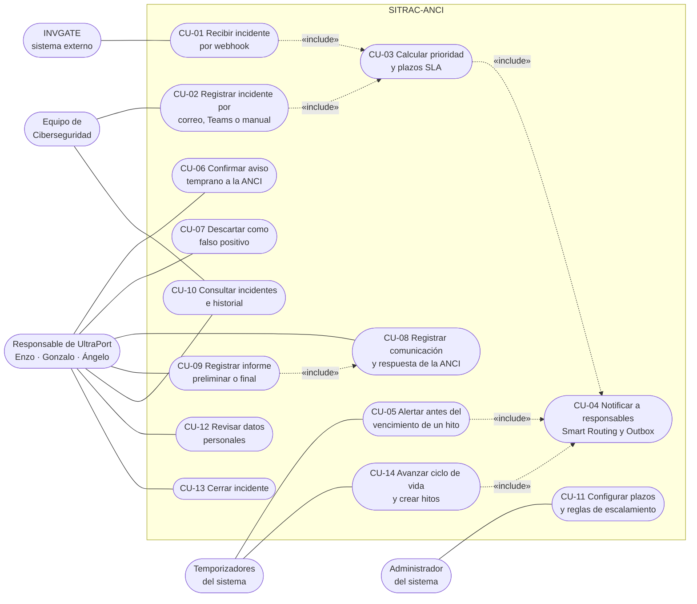
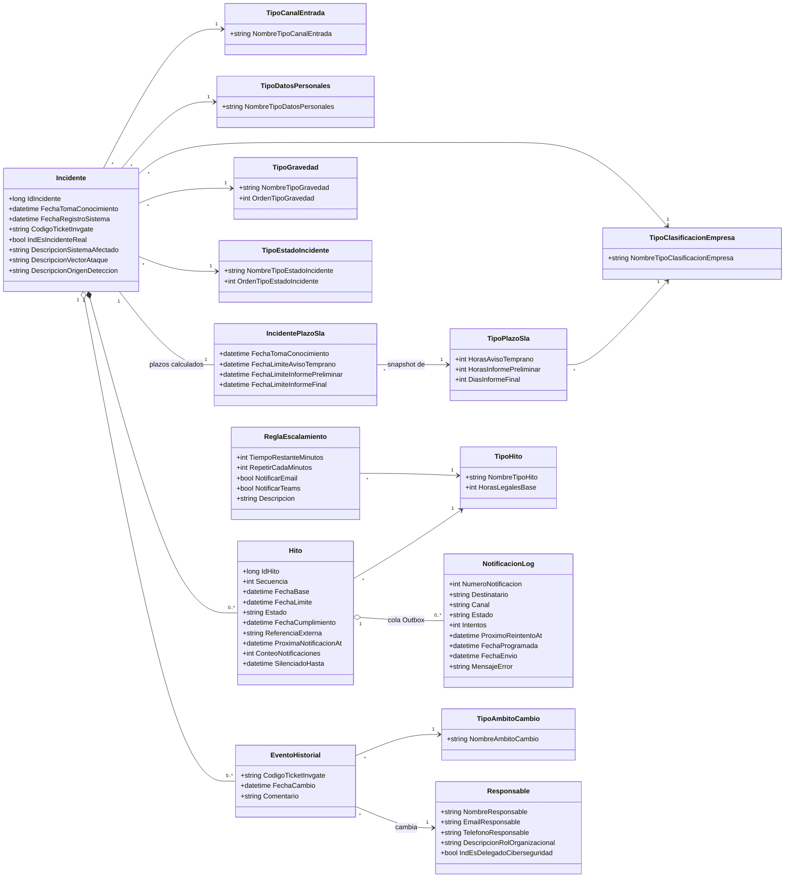
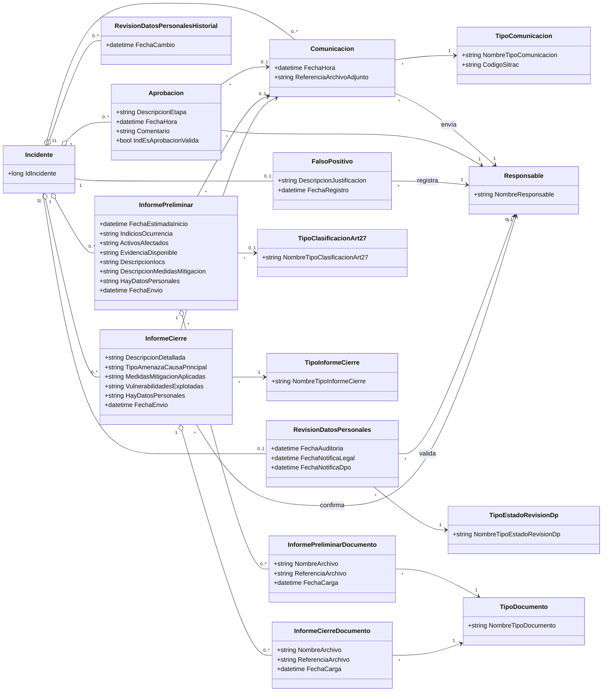
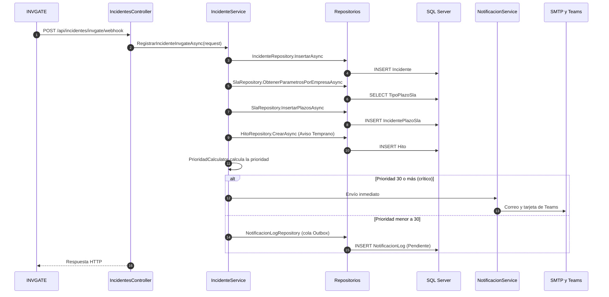
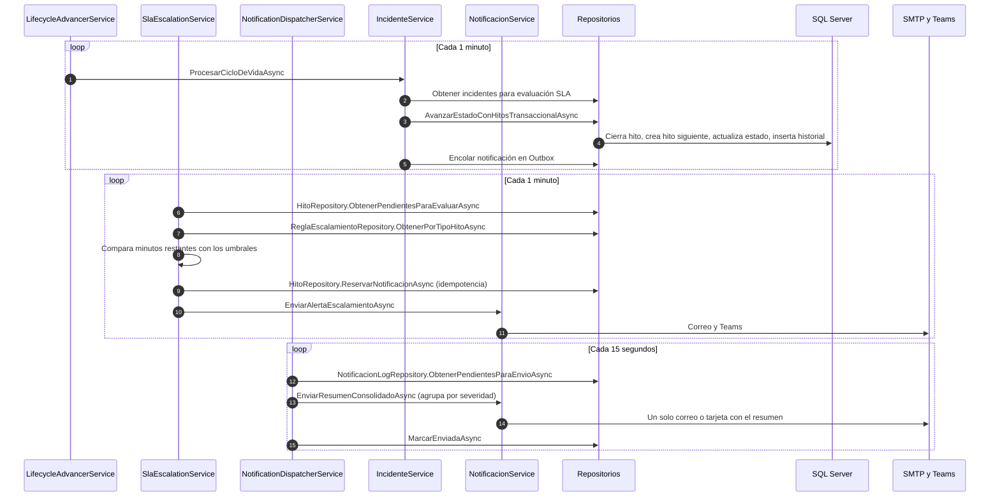
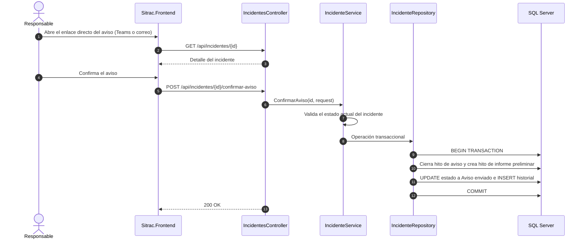
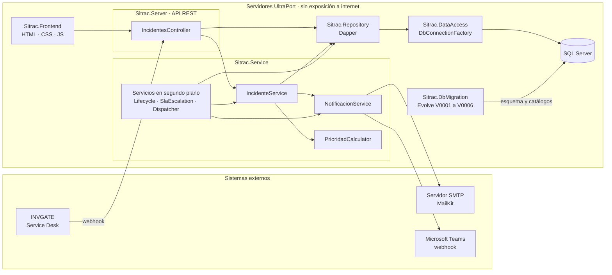

# Diagramas UML — SITRAC

**Proyecto CAPSTONE 2026 PTY4614 · DuocUC sede Valparaíso · Empresa mandante: UltraPort**
**Autores:** Rodrigo Ayala López, Benjamín Soto Aguilar

##Diagrama de casos de uso

| Caso de uso | Descripción | Requisitos | Estado según `ARCHITECTURE.md` |
| --- | --- | --- | --- |
| CU-01 | Recibe el ticket de INVGATE por `POST /api/incidentes/invgate/webhook` y lo registra. | RF-01 | Implementado |
| CU-02 | Registra incidentes que llegan por correo (ANCI o equipo de ciberseguridad), Teams o ingreso manual. Los canales existen en el catálogo. | RF-10, RF-11 | Pendiente: hoy solo existe el webhook |
| CU-03 | Calcula la prioridad y los tres plazos (aviso 3 h, preliminar 72 h o 24 h, final 15 días) según la clasificación de la empresa. | RF-12, RF-13 | Implementado |
| CU-04 | Envía el aviso por correo y Teams: inmediato si la prioridad es 30 o más, diferido y consolidado por Outbox en los demás casos. | RF-02 | Implementado |
| CU-05 | Envía alertas preventivas cuando faltan los minutos definidos en las reglas de escalamiento. | RF-02 | Implementado |
| CU-06 | Un responsable confirma el aviso (`POST .../confirmar-aviso`): cierra el hito de aviso y crea el del informe preliminar. | RF-03, RF-05 | Implementado |
| CU-07 | Descarta el incidente con justificación y detiene el flujo. La tabla existe. | RF-04 | Pendiente: sin endpoint |
| CU-08 | Registra la comunicación con la ANCI y su respuesta. | RF-06 | Parcial: tabla creada, sin endpoint propio |
| CU-09 | Registra el informe preliminar o final con datos CSIRT y DPO (`POST .../informe`). | RF-07, RF-08, RF-09 | Implementado |
| CU-10 | Lista incidentes activos, muestra el detalle y su historial. | RNF-06 | Implementado |
| CU-11 | Cambia plazos y reglas de escalamiento modificando los parámetros en base de datos. | RNF-05 | Parcial: sin interfaz |
| CU-12 | Registra la auditoría de datos personales de un incidente. | RF-14 | Pendiente: sin endpoint |
| CU-13 | Cierra definitivamente el incidente (`POST .../cerrar`). | RF-09 | Implementado |
| CU-14 | `LifecycleAdvancerService` avanza estados y crea hitos cada minuto. | RNF-01 | Implementado |

---

## 3. Diagramas de clases (modelo de dominio)

Reflejan las tablas creadas en `V0001` a `V0006`, sin el prefijo `TbSitrac`. Se omiten las columnas de auditoría (`AuditNotDeleted`, `AuditCreateDate`, `AuditLastUpdateDate`, `AuditUserLastUpdate`), presentes en todas las tablas.

### 3.1 Núcleo: incidente, plazos, hitos y notificaciones

Notas de lectura:
- Los tres plazos legales se guardan al registrar el incidente en `IncidentePlazoSla`. Los hitos (`Hito`) se crean de forma progresiva: primero el de aviso temprano y luego los siguientes al avanzar el ciclo de vida.
- `EventoHistorial` también referencia estados de incidente, estados de revisión de datos personales y gravedades anteriores y nuevas.
- `NotificacionLog` guarda el destinatario como texto y no se relaciona con `Responsable`.

### Comunicaciones, informes y revisión de datos personales

---

## Diagramas de secuencia

### Registro de un incidente desde INVGATE

### Servicios en segundo plano: ciclo de vida, escalamiento y Outbox

###  Confirmación del aviso temprano por un responsable

---

##Diagrama de componentes

| Componente | Responsabilidad | Tecnología |
| --- | --- | --- |
| `Sitrac.Frontend` | Registro, seguimiento y pantallas de acción. | HTML, CSS, JavaScript |
| `Sitrac.Server` | Endpoints REST: webhook, consulta, confirmar aviso, informe y cierre. | ASP.NET Core |
| `Sitrac.Service` | Reglas de negocio, prioridad, ciclo de vida, escalamiento y notificaciones. | C#, `BackgroundService` |
| `Sitrac.Repository` | Repositorios de incidentes, hitos, SLA, Outbox y reglas de escalamiento. | Dapper |
| `Sitrac.DataAccess` | Fábrica de conexiones a SQL Server. | Microsoft.Data.SqlClient |
| `Sitrac.DbMigration` | Scripts versionados de esquema y catálogos. | Evolve, T-SQL |

---

## Trazabilidad entre diagramas y requisitos

| Diagrama | Requisitos que cubre |
| --- | --- |
| Casos de uso | RF-01 a RF-14, RNF-05, RNF-06 |
| Clases 3.1 | RF-12, RF-13, RNF-01, RNF-05, RNF-06 |
| Clases 3.2 | RF-04, RF-05 a RF-09, RF-14 |
| Secuencia 4.1 | RF-01, RF-02, RF-13 |
| Secuencia 4.2 | RF-02, RNF-01, RNF-03 |
| Secuencia 4.3 | RF-03, RF-05 |
| Componentes | RNF-04, RNF-07, restricción de despliegue sin exposición a internet |

