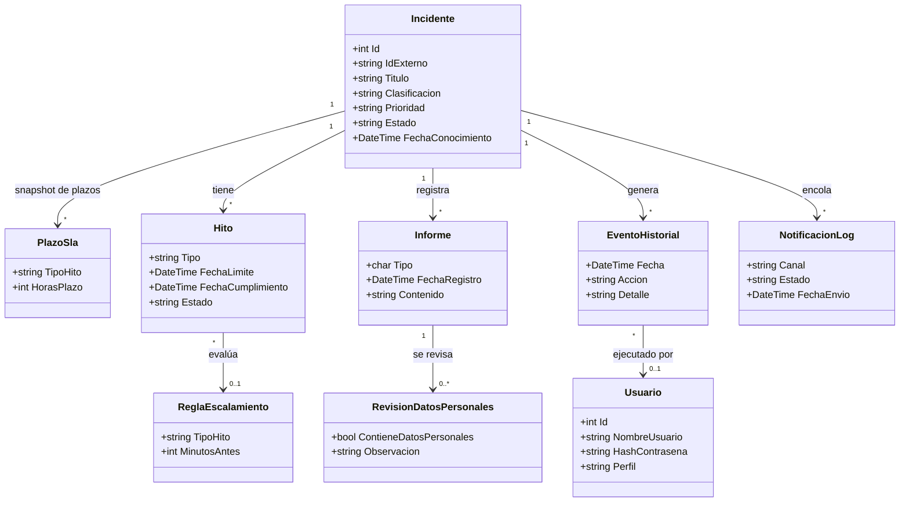
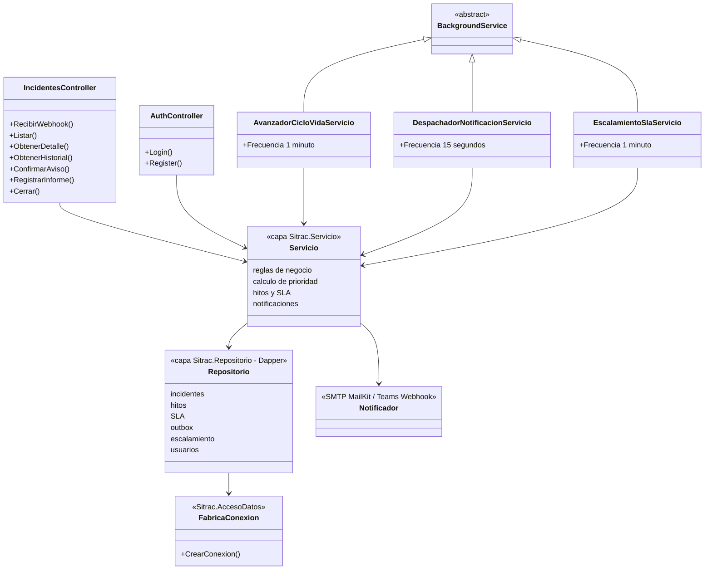
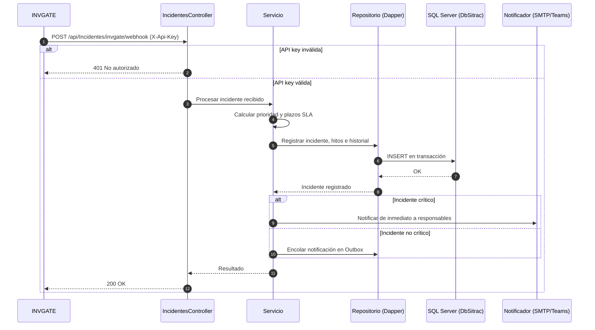
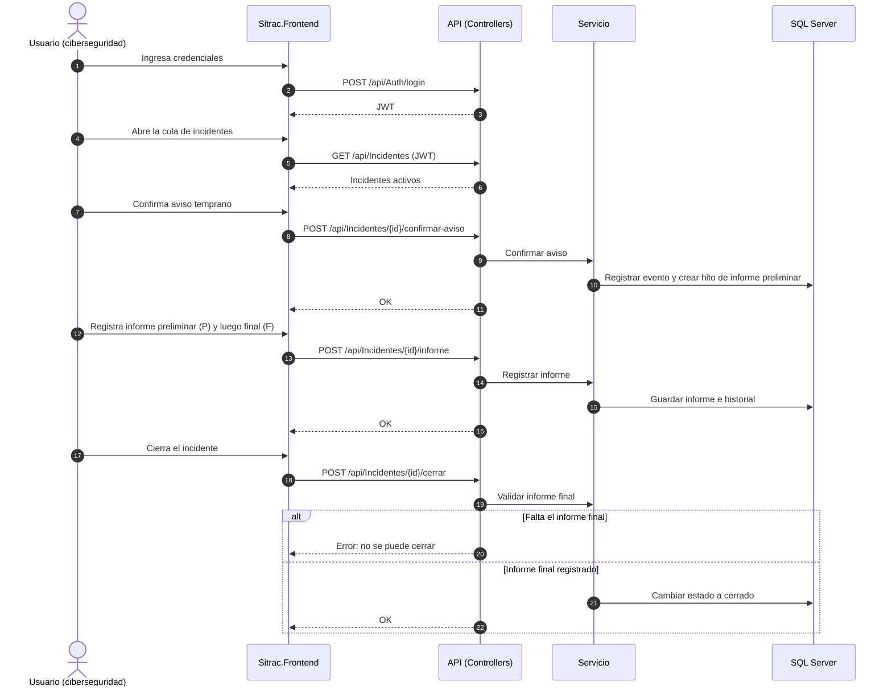
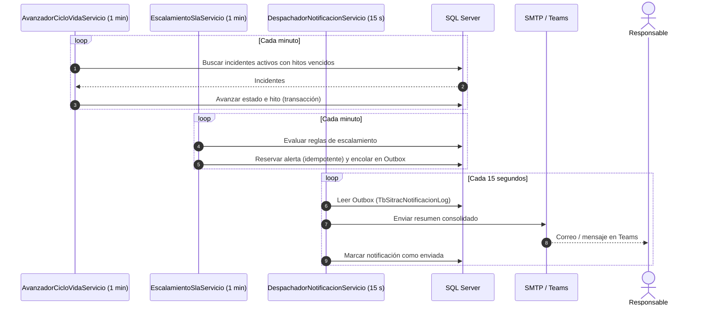

# Diagramas UML — SITRAC-ANCI (clases y secuencia)

Complementan los diagramas de casos de uso y de componentes que ya existen en el repositorio. Los diagramas están en Mermaid, por lo que GitHub los renderiza directamente.

> **Nota de validación:** los nombres de clases de dominio y sus atributos son una primera versión basada en el README y en la arquitectura. Antes de entregar, contrastarlos con los modelos reales de `Sitrac.Repositorio/` y con `Diccionario_de_Datos_SITRAC.xlsx`.

---

## 1. Diagrama de clases — dominio

## 2. Diagrama de clases — servicios y capas

---

## 3. Diagrama de secuencia — recepción de un incidente desde INVGATE

## 4. Diagrama de secuencia — gestión del incidente por el usuario

## 5. Diagrama de secuencia — procesos en segundo plano (ciclo de vida, Outbox y escalamiento)

