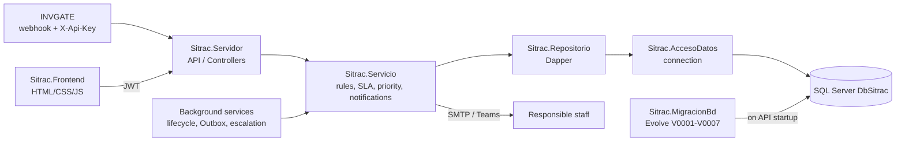

# SITRAC-ANCI

**Incident Traceability and Automatic Notification System for Cybersecurity Incidents to ANCI**

[](#additional-information)
[](#5-work-methodology)
[](#1-project-description)
[](#2-technologies-used)

[🇪🇸 Español](README.md) · 🇬🇧 English

> CAPSTONE 2026 project (PTY4614) for the Computer Engineering program, DuocUC – School of Informatics and Telecommunications, Valparaíso campus. Developed together with the client company **UltraPort**.

---

## 1. Project description

**What does the solution do?** SITRAC-ANCI receives cybersecurity incidents (currently from **INVGATE** via webhook, protected by an API key), centralizes their traceability in a dedicated database, and **automatically notifies responsible stakeholders** to support compliance with the reporting deadlines required by Chile's **National Cybersecurity Agency (ANCI)**. It records milestones, action history, preliminary/final reports, and the incident lifecycle progress.

**Who is it for?** UltraPort's cybersecurity team and the people responsible for managing and approving actions related to regulatory reporting.

**What problem does it solve?** **Law No. 21.663** requires incidents to be reported within strict deadlines:

| Milestone | Deadline |
| --- | --- |
| Early warning | Maximum of **3 hours** from becoming aware of the incident |
| Preliminary report | **72 hours** (Essential entity) or **24 hours** (OIV), depending on classification |
| Final report | **15 days** |

**General objective:** automate the traceability and notification of UltraPort's cybersecurity incidents to ANCI, facilitating compliance with the deadlines set by Law No. 21.663.

## 2. Technologies used

- **Languages:** C# (.NET 10), T-SQL, HTML, CSS and JavaScript (native ES modules)
- **Backend:** ASP.NET Core Web API (controllers), JWT Bearer, rate limiting, CORS
- **Data access:** Dapper + `Microsoft.Data.SqlClient` (parameterized SQL, transactions)
- **Database:** SQL Server
- **Migrations:** EvolveDB (versioned scripts `V0001`–`V0007`, executed on API startup)
- **Notifications:** MailKit/MimeKit (SMTP) and Microsoft Teams (Incoming Webhook + Adaptive Cards)
- **Background processing:** `BackgroundService` + `PeriodicTimer` (lifecycle, Outbox, SLA escalation)
- **Frontend:** static web UI (`Sitrac.Frontend`, HTML/CSS/JS, no bundler)
- **Local infrastructure:** Docker / Docker Compose (SQL Server 2022, smtp4dev, API)

> **.NET note:** the project targets **.NET 10** (`net10.0`) and the SDK is pinned in `global.json` to `10.0.400` (`rollForward: latestFeature`).

## 3. Repository structure

| Project / folder | Responsibility |
| --- | --- |
| `Sitrac.Servidor/` | REST API, DI composition, authentication/authorization, rate limiting, CORS, and Evolve migrations on startup |
| `Sitrac.Servicio/` | Business rules, priority calculation, lifecycle, notifications, and background services |
| `Sitrac.Repositorio/` | Dapper models and repositories (incidents, milestones, SLA, outbox, escalation, users) |
| `Sitrac.AccesoDatos/` | SQL Server connection factory |
| `Sitrac.MigracionBd/Scripts/` | Versioned SQL migrations (`V0001`–`V0007`) |
| `Sitrac.Frontend/` | Web console (login and operational management) |
| `docker-compose.yml` | Local stack: SQL Server, smtp4dev, and API |
| `Sitrac.dockerfile` | Multi-stage API image |

## 4. Instructions to run the project locally

### Requirements

- .NET 10 SDK (as pinned in `global.json`)
- SQL Server (local/Docker) or Docker Desktop for the full stack
- Static file server for the frontend on port `5500` (CORS allows only `http://localhost:5500` and `http://127.0.0.1:5500`)

### Option A: Docker Compose (recommended for development)

```bash
# From the repository root
docker compose up --build
```

Exposed services:

| Service | URL / port |
| --- | --- |
| SITRAC API | `http://localhost:5116` |
| SQL Server | `localhost:1433` (sa / `Sitrac2026!Strong`) |
| smtp4dev (email capture) | `http://localhost:5000` |

The API automatically runs Evolve migrations on startup and creates the `DbSitrac` database if it does not exist.

### Option B: Run locally with .NET

```bash
# 1. Restore and build
dotnet restore Sitrac.sln
dotnet build Sitrac.sln

# 2. Configure connection and secrets
#    - ConnectionStrings:SitracConnection
#    - JwtSettings (SecretKey, Issuer, Audience)
#    - WebhookApiKey
#    - SmtpConfig / TeamsConfig / FrontendSettings
#    Recommended: user-secrets or environment variables (do not commit secrets)

# 3. Run the API
dotnet run --project Sitrac.Servidor/Sitrac.Servidor.csproj --launch-profile http
```

- The API listens by default on `http://localhost:5116` (`http` profile).
- In the Development environment, Swagger is enabled at `/swagger`.
- Migrations are applied on startup from `../Sitrac.MigracionBd/Scripts` relative to the server project.

### Frontend

```bash
# Serve on the port allowed by CORS
npx serve Sitrac.Frontend -l 5500
# or VS Code Live Server on port 5500
```

- Login: `http://localhost:5500/login.html`
- Console: `http://localhost:5500/index.html`
- The API base URL is defined in `Sitrac.Frontend/js/api.js` and `Sitrac.Frontend/js/login.js` (`http://localhost:5116/api`).

## 5. Work methodology

The project is developed with **Scrum**, with sprints aligned to the CAPSTONE weeks (August 10 to December 12, 2026), managed on Trello (Product Backlog and Sprint Backlog).

**Ceremonies:** sprint planning, Sprint Review with the client, and retrospective.

**Stages:** requirements gathering and formalization, architecture and data model design, iterative development, testing, documentation, and final presentation.

Scrum management evidence is available in [`Fase 2/Evidencias Proyecto/Evidencias de documentacion`](<Fase 2/Evidencias Proyecto/Evidencias de documentacion>).

## 6. Solution architecture

Layered backend in .NET 10, with SQL Server and Evolve migrations:



| Project | Responsibility |
| --- | --- |
| `Sitrac.Servidor` | API controllers, JWT, rate limiting, CORS, DI, and migration startup |
| `Sitrac.Servicio` | Use cases, priority, milestones/SLA, notifications, and background workers |
| `Sitrac.Repositorio` | Persistence and transactional queries (Dapper) |
| `Sitrac.AccesoDatos` | Connection factory |
| `Sitrac.MigracionBd` | Schema and seed data scripts |
| `Sitrac.Frontend` | Operational console (login, queue, detail, actions, guide) |

### Background services

| Service | Frequency | Function |
| --- | --- | --- |
| `AvanzadorCicloVidaServicio` | 1 minute | Evaluates active incidents and advances states/milestones based on SLA deadlines (transactional) |
| `DespachadorNotificacionServicio` | 15 seconds | Processes the Outbox queue (`TbSitracNotificacionLog`) and sends consolidated summaries |
| `EscalamientoSlaServicio` | 1 minute | Evaluates escalation rules and sends preventive alerts with idempotent reservation |

### Main endpoints

| Method | Route | Auth | Description |
| --- | --- | --- | --- |
| `POST` | `/api/Auth/login` | No | Authentication and JWT issuance |
| `POST` | `/api/Auth/register` | No | User registration (bootstrap/development; creates Admin profile) |
| `POST` | `/api/Incidentes/invgate/webhook` | `X-Api-Key` | Incident intake from INVGATE |
| `GET` | `/api/Incidentes` | JWT | List active incidents |
| `GET` | `/api/Incidentes/{id}` | JWT | Incident detail |
| `GET` | `/api/Incidentes/{id}/historial` | JWT | Event history |
| `POST` | `/api/Incidentes/{id}/confirmar-aviso` | JWT | Confirms early warning and creates the preliminary report milestone |
| `POST` | `/api/Incidentes/{id}/informe` | JWT | Registers preliminary (`P`) or final (`F`) report |
| `POST` | `/api/Incidentes/{id}/cerrar` | JWT | Closes the incident (requires final report registered) |

### Security and relevant configuration

- **JWT Bearer** for protected endpoints (`JwtSettings`).
- **INVGATE webhook** validated via `X-Api-Key` header (`WebhookApiKey`).
- **Global rate limiting:** 100 requests/minute per user or IP (429 on excess).
- **CORS:** allowed origins `http://localhost:5500` and `http://127.0.0.1:5500`.
- **Notifications:** SMTP (`SmtpConfig`) and Teams (`TeamsConfig`, disabled by default); critical incidents can be notified immediately, others are consolidated via Outbox.

### Data model and migrations

Evolve migrations (`V0001`–`V0007`) create catalogs, operational tables, SLA, reports/reviews, history, milestones/escalation/outbox, and user authentication. Do not edit applied migrations; add a new version for future changes.

---

## Additional information

### Current status

| Component | Status |
| --- | --- |
| Data model and migrations `V0001`–`V0007` | ✅ |
| Layered backend (.NET 10), INVGATE webhook with API key | ✅ |
| Priority calculation and SLA deadline snapshot | ✅ |
| Milestones, history, and automatic lifecycle advancement | ✅ |
| SMTP/Teams notifications, Outbox, and SLA escalation | ✅ |
| JWT authentication and frontend login | ✅ Implemented (production hardening pending) |
| Operational frontend (login, queue, detail, actions) | 🚧 In development |
| Full integration with real INVGATE API/credentials | ⏳ Pending |
| False positive, personal data review, and additional channels | ⏳ Pending |

### Known scope and limitations

- MVP limited to the main traceability/notification flow within the CAPSTONE period.
- `POST /api/Auth/register` is an unprotected bootstrap endpoint that creates `Admin` users; it must be restricted/removed for production.
- The seeded `admin` user hash in `V0007` is a placeholder and not valid for real PBKDF2 login.
- Frontend API URLs and CORS origins are fixed to the local environment; deployment requires parameterization.
- INVGATE integration depends on client-provided credentials/configuration.
- The repository does not include an automated test suite; current verification is build + manual testing.

### Team members and roles

| Member | Role |
| --- | --- |
| Ayala López, Rodrigo | Project Management and Regulatory Compliance |
| Soto Aguilar, Benjamín | Backend Development, architecture, and testing |

- **Client company:** UltraPort
- **Thesis advisor:** María Ignacia Cobo

### References

- Ministerio del Interior y Seguridad Pública. (2024, April 8). *Ley 21.663: Ley marco de ciberseguridad e infraestructura crítica de la información*. https://www.bcn.cl/leychile/navegar?idNorma=1202434
- Agencia Nacional de Ciberseguridad. (n.d.). *ANCI*. https://www.anci.gob.cl/
- Schwaber, K., & Sutherland, J. (2020). *The Scrum Guide*. https://scrumguides.org/
- INVGATE. (n.d.). *INVGATE Service Desk*. https://www.invgate.com/

---

<sub>Academic project developed as part of the professional internship and CAPSTONE, DuocUC Valparaíso campus, with the client company UltraPort.</sub>
