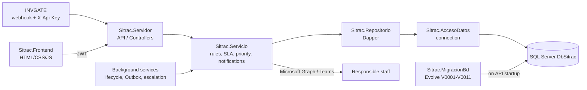

# SITRAC-ANCI

**Incident Traceability and Automatic Notification System for Cybersecurity Incidents to ANCI**

[](#additional-information)
[](#5-work-methodology)
[](#1-project-description)
[](#2-technologies-used)

[🇪🇸 Español](README.md) · 🇬🇧 English

> CAPSTONE 2026 project (PTY4614) for the Computer Engineering program, DuocUC – School of Informatics and Telecommunications, Valparaíso campus. Developed together with the client company **UltraPort**.

---

## 1. Project description

**What does the solution do?** SITRAC-ANCI receives cybersecurity incidents (currently from **INVGATE** via webhook, protected by an API key), centralizes their traceability in a dedicated database, and **automatically notifies responsible stakeholders** to support compliance with the reporting deadlines required by Chile's **National Cybersecurity Agency (ANCI)**. It records milestones, action history, preliminary/final reports, and the incident lifecycle progress.

**Who is it for?** UltraPort's cybersecurity team and the people responsible for managing and approving actions related to regulatory reporting.

**What problem does it solve?** **Law No. 21.663** requires incidents to be reported within strict deadlines:

| Milestone | Deadline |
| --- | --- |
| Early warning | Maximum of **3 hours** from becoming aware of the incident |
| Preliminary report | **72 hours** (Essential entity) or **24 hours** (OIV), depending on classification |
| Final report | **15 days** |

**General objective:** automate the traceability and notification of UltraPort's cybersecurity incidents to ANCI, facilitating compliance with the deadlines set by Law No. 21.663.

## 2. Technologies used

- **Languages:** C# (.NET 10), T-SQL, HTML, CSS and JavaScript (native ES modules)
- **Backend:** ASP.NET Core Web API (controllers), JWT Bearer, rate limiting, CORS
- **Data access:** Dapper + `Microsoft.Data.SqlClient` (parameterized SQL, transactions)
- **Database:** SQL Server
- **Migrations:** EvolveDB (versioned scripts `V0001`–`V0011`, executed on API startup)
- **Notifications:** Microsoft Graph SDK `6.10.0` + Azure.Identity `1.21.0` (App-Only `POST /users/{RemitenteUpn}/sendMail`) and Microsoft Teams (Incoming Webhook + Adaptive Cards); no SMTP or local mail catcher
- **Background processing:** `BackgroundService` + `PeriodicTimer` (lifecycle, Outbox, SLA escalation)
- **Frontend:** static web UI (`Sitrac.Frontend`, HTML/CSS/JS, no bundler)
- **Local infrastructure:** Docker / Docker Compose (SQL Server 2022, API)

> **.NET note:** the project targets **.NET 10** (`net10.0`) and the SDK is pinned in `global.json` to `10.0.400` (`rollForward: latestFeature`).

## 3. Repository structure

| Project / folder | Responsibility |
| --- | --- |
| `Sitrac.Servidor/` | REST API, DI composition, authentication/authorization, rate limiting, CORS, and Evolve migrations on startup |
| `Sitrac.Servicio/` | Business rules, priority calculation, lifecycle, notifications, and background services |
| `Sitrac.Repositorio/` | Dapper models and repositories (incidents, milestones, SLA, outbox, escalation, users) |
| `Sitrac.AccesoDatos/` | SQL Server connection factory |
| `Sitrac.MigracionBd/Scripts/` | Versioned SQL migrations (`V0001`–`V0011`) |
| `Sitrac.Frontend/` | Web console (login and operational management) |
| `.env.example` | Environment variable template for SQL Server, JWT, webhook, Graph, Teams, frontend, and bootstrap |
| `docker-compose.yml` | Local stack: SQL Server and API, without versioned secrets |
| `Sitrac.dockerfile` | Multi-stage API image |

## 4. Instructions to run the project locally

### Requirements

- .NET 10 SDK (as pinned in `global.json`)
- SQL Server (local/Docker) or Docker Desktop for the full stack
- Static file server for the frontend on port `5500` (CORS configured through `FrontendSettings:AllowedOrigins`)

### Option A: Docker Compose (recommended for development)

```bash
# From the repository root
cp .env.example .env
# Fill in UltraPort secrets and URLs in .env
docker compose up --build -d
docker compose ps
docker compose logs -f sitrac-api
```

Exposed services:

| Service | URL / port |
| --- | --- |
| SITRAC API | `http://127.0.0.1:5117` |
| SQL Server | `localhost:1433` (credentials defined in `.env`) |

The API automatically runs Evolve migrations on startup and creates the `DbSitrac` database if it does not exist.

All secrets are provided through `.env`/environment variables (or user-secrets when running outside Docker). They must not be written to versioned files. Microsoft Graph credentials use `GraphConfig__*` variables. `GraphConfig:DestinatarioCorreo` is optional: when empty, active delegates from `TbSitracResponsable` are used.

### Option B: Run locally with .NET

```bash
# 1. Restore and build
dotnet restore Sitrac.sln
dotnet build Sitrac.sln

# 2. Configure connection and secrets
#    - ConnectionStrings:SitracConnection
#    - JwtSettings (SecretKey, Issuer, Audience)
#    - WebhookApiKey
#    - GraphConfig / TeamsConfig / FrontendSettings
#    Recommended: user-secrets or environment variables (do not commit secrets)

# 3. Run the API from the server folder
cd Sitrac.Servidor
dotnet run --launch-profile http
```

- The API listens by default on `http://127.0.0.1:5117` (`http` profile).
- In the Development environment, Swagger is enabled at `/swagger`.
- Run from `Sitrac.Servidor/`: `Program.cs` looks for Evolve scripts in `../Sitrac.MigracionBd/Scripts`, relative to the working directory. Changing the CWD breaks migration startup.

### Frontend

```bash
# Serve on the port allowed by CORS
npx serve Sitrac.Frontend -l 5500
# or VS Code Live Server on port 5500
```

- Login: `http://127.0.0.1:5500/login.html`
- Console: `http://127.0.0.1:5500/index.html`
- The API base URL has a single source in `Sitrac.Frontend/js/api.js` (`http://127.0.0.1:5117/api`). `login.js` reuses `SitracAPI.login`. It can be overridden with `window.SITRAC_API_BASE_URL` before loading the modules.
- For an UltraPort deployment, copy `Sitrac.Frontend/js/config.example.js` to `js/config.js`; optional script includes are already prepared in `login.html` and `index.html`.

## 5. Work methodology

The project is developed with **Scrum**, with sprints aligned to the CAPSTONE weeks (August 10 to December 12, 2026), managed on Trello (Product Backlog and Sprint Backlog).

**Ceremonies:** sprint planning, Sprint Review with the client, and retrospective.

**Stages:** requirements gathering and formalization, architecture and data model design, iterative development, testing, documentation, and final presentation.

Scrum management evidence is available in [`Fase 2/Evidencias Proyecto/Evidencias de documentacion`](<Fase 2/Evidencias Proyecto/Evidencias de documentacion>).

## 6. Solution architecture

Layered backend in .NET 10, with SQL Server and Evolve migrations. Details are in [ARCHITECTURE.md](ARCHITECTURE.md) and the functional transaction guide is in [TRANSACCIONES.md](TRANSACCIONES.md):



| Project | Responsibility |
| --- | --- |
| `Sitrac.Servidor` | API controllers, JWT, rate limiting, CORS, DI, and migration startup |
| `Sitrac.Servicio` | Use cases, priority, milestones/SLA, notifications, and background workers |
| `Sitrac.Repositorio` | Persistence and transactional queries (Dapper) |
| `Sitrac.AccesoDatos` | Connection factory |
| `Sitrac.MigracionBd` | Schema and seed data scripts |
| `Sitrac.Frontend` | Operational console (login, queue, detail, actions, guide) |

### Background services

| Service | Frequency | Function |
| --- | --- | --- |
| `AvanzadorCicloVidaServicio` | 1 minute | Evaluates active incidents and advances states/milestones based on SLA deadlines (transactional) |
| `DespachadorNotificacionServicio` | 15 seconds | Processes the Outbox queue (`TbSitracNotificacionLog`) and sends consolidated summaries |
| `EscalamientoSlaServicio` | 1 minute | Evaluates escalation rules and sends preventive alerts with idempotent reservation |

### Main endpoints

| Method | Route | Auth | Description |
| --- | --- | --- | --- |
| `POST` | `/api/Auth/login` | No | Authentication and JWT issuance |
| `POST` | `/api/Auth/bootstrap` | No (one-shot) | Creates the initial administrator; returns `403` when disabled and `409` if it already exists |
| `POST` | `/api/Auth/register` | `SITR_AUTE_REGISTRAR_USUARIO` | User registration; assigns `NombreRol` when provided |
| `POST` | `/api/Incidentes/invgate/webhook` | `X-Api-Key` | Incident intake from INVGATE |
| `GET` | `/api/Incidentes` | `SITR_INCI_CONSULTAR_INCIDENTES` | List active incidents |
| `GET` | `/api/Incidentes/{id}` | `SITR_INCI_CONSULTAR_INCIDENTE` | Incident detail |
| `GET` | `/api/Incidentes/{id}/historial` | `SITR_INCI_CONSULTAR_HISTORIAL` | Event history |
| `POST` | `/api/Incidentes/{id}/confirmar-aviso` | `SITR_INCI_CONFIRMAR_AVISO` | Confirms early warning and creates the preliminary report milestone |
| `POST` | `/api/Incidentes/{id}/informe` | `SITR_INCI_REGISTRAR_INFORME` | Registers preliminary (`P`) or final (`F`) report |
| `POST` | `/api/Incidentes/{id}/cerrar` | `SITR_INCI_CERRAR_INCIDENTE` | Closes the incident (requires final report registered) |

### Security and relevant configuration

- **JWT Bearer** for protected endpoints (`JwtSettings`).
- **Transaction authorization:** 9 `SITR_*` codes, one `transaccion` claim per code, and policies generated from `TransaccionesCatalogo`; controlled by `Seguridad:HabilitarAutorizacionPorTransaccion`.
- **Bootstrap** `/api/Auth/bootstrap`: anonymous and one-shot; controlled by `Seguridad:HabilitarBootstrap` and creates the initial administrator with the `Administrador SITRAC` role.
- **Registration** `/api/Auth/register`: accepts `NombreRol`, validates that the role is active, and assigns it; when omitted, explicit SQL assignment is required.
- **INVGATE webhook** validated via `X-Api-Key` header (`WebhookApiKey`).
- **Global rate limiting:** 100 requests/minute per user or IP (429 on excess).
- **CORS:** allowed origins defined in `FrontendSettings:AllowedOrigins`, with local fallback when the array is empty.
- **Notifications:** Microsoft Graph (`GraphConfig`, App-Only `sendMail`) and Teams (`TeamsConfig`, disabled by default); critical incidents can be notified immediately, others are consolidated via Outbox with retries, per-channel processing, and email traceability.

### Data model and migrations

Evolve migrations (`V0001`–`V0011`) create catalogs, operational tables, SLA, reports/reviews, history, milestones/escalation/outbox, user authentication, and transaction security (modules, transactions, profiles, and roles). V0010 adds email auditing and idempotency to the outbox; V0011 automatically removes the invalid seed user from `V0007` (`admin`, `IdUsuario = 1`) when it still has the placeholder hash or the originally seeded hash. No manual deletion is required. Do not edit applied migrations; use `V0012` onward for future changes.

---

## Additional information

### Current status

| Component | Status |
| --- | --- |
| Data model and migrations `V0001`–`V0011` (including automatic V0011 cleanup) | ✅ Completed |
| Layered backend (.NET 10), INVGATE webhook with API key | ✅ Completed |
| Priority calculation and SLA deadline snapshot (Law No. 21.663) | ✅ Completed |
| Milestones, history, and automatic lifecycle advancement | ✅ Completed |
| Microsoft Graph App-Only email (`sendMail`) with Azure.Identity | ✅ Completed (UltraPort credentials pending) |
| Recipient resolution from `TbSitracResponsable` when `DestinatarioCorreo` is empty | ✅ Completed |
| Outbox with idempotency, retries, per-channel processing, and traceability | ✅ Completed |
| Teams notifications and SLA escalation | ✅ Completed (Teams disabled by default) |
| JWT authentication and authorization through 9 `SITR_*` transactions | ✅ Completed (production hardening pending) |
| Bootstrap control via `Seguridad:HabilitarBootstrap` | ✅ Completed |
| Optional `NombreRol` assignment in `/api/Auth/register` | ✅ Completed |
| Frontend with configurable API base URL (`config.example.js` → `config.js`) | ✅ Completed |
| CORS configured through `FrontendSettings:AllowedOrigins` | ✅ Completed |
| `.env.example` + Docker Compose without versioned secrets | ✅ Completed |
| Handoff runbook [`TRASPASO_ULTRAPORT.md`](TRASPASO_ULTRAPORT.md) | ✅ Completed |
| Deployment with real INVGATE / Graph credentials | ⏳ Pending from UltraPort |
| False positive, personal data review, and additional channels | ⏳ Pending |

### Known scope and limitations

- MVP limited to the main traceability/notification flow within the CAPSTONE period.
- `POST /api/Auth/bootstrap` is anonymous and one-shot; set `Seguridad:HabilitarBootstrap = false` after the initial deployment.
- `POST /api/Auth/register` requires the `SITR_AUTE_REGISTRAR_USUARIO` transaction; it creates users with legacy `Rol = "Admin"` and assigns the role supplied in `NombreRol`. When omitted, explicit SQL assignment is required.
- V0011 automatically removes the seeded `admin` user (`IdUsuario = 1`) from `V0007` when it still has the placeholder hash or the originally seeded hash; do not run manual `DELETE` statements. If the database was already migrated, verify with the `SELECT` described in [`MANUAL.md`](MANUAL.md) before bootstrap.
- Frontend API URLs and CORS origins are configurable through `window.SITRAC_API_BASE_URL` and `FrontendSettings:AllowedOrigins`.
- INVGATE integration depends on client-provided credentials/configuration.
- The repository does not include an automated test suite; current verification is build + manual testing.

### Team members and roles

| Member | Role |
| --- | --- |
| Ayala López, Rodrigo | Project Management and Regulatory Compliance |
| Soto Aguilar, Benjamín | Backend Development, architecture, and testing |

- **Client company:** UltraPort
- **Thesis advisor:** María Ignacia Cobo

### References

- [`TRASPASO_ULTRAPORT.md`](TRASPASO_ULTRAPORT.md): executive implementation guide, environment variables, deployment, INVGATE integration, and post-go-live verification.
- [`MANUAL.md`](MANUAL.md): installation, configuration, bootstrap, users, frontend, and troubleshooting.
- [`ARCHITECTURE.md`](ARCHITECTURE.md), [`TRANSACCIONES.md`](TRANSACCIONES.md), and [`test.md`](test.md): technical detail, security, and tests T01–T22.
- Ministerio del Interior y Seguridad Pública. (2024, April 8). *Ley 21.663: Ley marco de ciberseguridad e infraestructura crítica de la información*. https://www.bcn.cl/leychile/navegar?idNorma=1202434
- Agencia Nacional de Ciberseguridad. (n.d.). *ANCI*. https://www.anci.gob.cl/
- Schwaber, K., & Sutherland, J. (2020). *The Scrum Guide*. https://scrumguides.org/
- INVGATE. (n.d.). *INVGATE Service Desk*. https://www.invgate.com/

---

<sub>Academic project developed as part of the professional internship and CAPSTONE, DuocUC Valparaíso campus, with the client company UltraPort.</sub>
