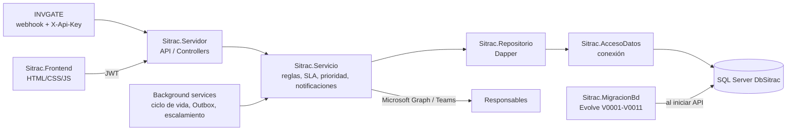

# SITRAC-ANCI

**Sistema de Trazabilidad y Notificación Automática de Incidentes de Ciberseguridad a la ANCI**

[](#información-adicional)
[](#5-metodología-de-trabajo)
[](#1-descripción-del-proyecto)
[](#2-tecnologías-utilizadas)

🇪🇸 Español · [🇬🇧 English](README.en.md)

> Proyecto CAPSTONE 2026 (PTY4614) de Ingeniería en Informática, DuocUC – Escuela de Informática y Telecomunicaciones, sede Valparaíso. Desarrollado en conjunto con la empresa mandante **UltraPort**.

---

## 1. Descripción del proyecto

**¿Qué hace la solución?** SITRAC-ANCI recibe incidentes de ciberseguridad (actualmente desde **INVGATE** mediante webhook, con API key), centraliza su trazabilidad en una base de datos propia y **notifica automáticamente a los responsables** para apoyar el cumplimiento de los plazos de reporte a la **Agencia Nacional de Ciberseguridad (ANCI)**. Registra hitos, historial de acciones, informes preliminares/finales y el avance del ciclo de vida del incidente.

**¿A quién va dirigida?** Al equipo de ciberseguridad y a los responsables de UltraPort que deben gestionar y aprobar las acciones asociadas al reporte normativo.

**¿Qué problema resuelve?** La **Ley N° 21.663** obliga a notificar incidentes en plazos estrictos:

| Hito | Plazo |
| --- | --- |
| Aviso temprano | Máximo **3 horas** desde la toma de conocimiento |
| Informe preliminar | **72 horas** (Esencial) o **24 horas** (OIV), según clasificación |
| Informe final | **15 días** |

**Objetivo general:** automatizar la trazabilidad y notificación de incidentes de ciberseguridad de UltraPort a la ANCI, facilitando el cumplimiento de los plazos de la Ley N° 21.663.

## 2. Tecnologías utilizadas

- **Lenguajes:** C# (.NET 10), T-SQL, HTML, CSS y JavaScript (módulos ES nativos)
- **Backend:** ASP.NET Core Web API (controladores), JWT Bearer, rate limiting, CORS
- **Acceso a datos:** Dapper + `Microsoft.Data.SqlClient` (SQL parametrizado, transacciones)
- **Base de datos:** SQL Server
- **Migraciones:** EvolveDB (scripts versionados `V0001`–`V0011`, ejecutados al iniciar la API)
- **Notificaciones:** Microsoft Graph SDK `6.10.0` + Azure.Identity `1.21.0` (App-Only `POST /users/{RemitenteUpn}/sendMail`) y Microsoft Teams (Incoming Webhook + Adaptive Cards); sin SMTP ni capturadores de correo locales
- **Procesamiento en segundo plano:** `BackgroundService` + `PeriodicTimer` (ciclo de vida, Outbox, escalamiento SLA)
- **Frontend:** interfaz web estática (`Sitrac.Frontend`, HTML/CSS/JS, sin bundler)
- **Infraestructura local:** Docker / Docker Compose (SQL Server 2022, API)

> **Nota sobre .NET:** el proyecto apunta a **.NET 10** (`net10.0`) y el SDK se fija en `global.json` a `10.0.400` (`rollForward: latestFeature`).

## 3. Estructura del repositorio

| Proyecto / carpeta | Responsabilidad |
| --- | --- |
| `Sitrac.Servidor/` | API REST, composición DI, autenticación/autorización, rate limiting, CORS y ejecución de migraciones Evolve al arranque |
| `Sitrac.Servicio/` | Reglas de negocio, cálculo de prioridad, ciclo de vida, notificaciones y servicios en segundo plano |
| `Sitrac.Repositorio/` | Modelos y repositorios Dapper (incidentes, hitos, SLA, outbox, escalamiento, usuarios) |
| `Sitrac.AccesoDatos/` | Fábrica de conexiones a SQL Server |
| `Sitrac.MigracionBd/Scripts/` | Migraciones SQL versionadas (`V0001`–`V0011`) |
| `Sitrac.Frontend/` | Consola web (login y gestión operativa) |
| `.env.example` | Plantilla de variables de entorno para SQL Server, JWT, webhook, Graph, Teams, frontend y bootstrap |
| `docker-compose.yml` | Stack local: SQL Server y API, sin secretos versionados |
| `Sitrac.dockerfile` | Imagen multi-stage de la API |

## 4. Instrucciones para ejecutar el proyecto localmente

### Requisitos

- SDK de .NET 10 (según `global.json`)
- SQL Server (local/Docker) o Docker Desktop para el stack completo
- Servidor estático para el frontend en el puerto `5500` (CORS configurable mediante `FrontendSettings:AllowedOrigins`)

### Opción A: Docker Compose (recomendada para desarrollo)

```bash
# Desde la raíz del repositorio
cp .env.example .env
# Completar los secretos y URLs de UltraPort en .env
docker compose up --build -d
docker compose ps
docker compose logs -f sitrac-api
```

Servicios expuestos:

| Servicio | URL / puerto |
| --- | --- |
| API SITRAC | `http://127.0.0.1:5117` |
| SQL Server | `localhost:1433` (credenciales definidas en `.env`) |

La API ejecuta automáticamente las migraciones Evolve al iniciar y crea la base `DbSitrac` si no existe.

Todos los secretos se entregan por `.env`/variables de entorno (o user-secrets si se ejecuta fuera de Docker). No deben escribirse en archivos versionados. Las credenciales de Microsoft Graph usan variables `GraphConfig__*`. `GraphConfig:DestinatarioCorreo` es opcional: si está vacío, se usan los delegados activos de `TbSitracResponsable`.

### Opción B: Ejecución local con .NET

```bash
# 1. Restaurar y compilar
dotnet restore Sitrac.sln
dotnet build Sitrac.sln

# 2. Configurar conexión y secretos
#    - ConnectionStrings:SitracConnection
#    - JwtSettings (SecretKey, Issuer, Audience)
#    - WebhookApiKey
#    - GraphConfig / TeamsConfig / FrontendSettings
#    Recomendado: user-secrets o variables de entorno (no commitear secretos)

# 3. Ejecutar la API desde la carpeta del servidor
cd Sitrac.Servidor
dotnet run --launch-profile http
```

- La API escucha por defecto en `http://127.0.0.1:5117` (perfil `http`).
- En entorno Development se habilita Swagger en `/swagger`.
- Ejecute desde `Sitrac.Servidor/`: `Program.cs` busca los scripts de Evolve en `../Sitrac.MigracionBd/Scripts`, relativo al directorio de trabajo. Cambiar el CWD rompe el arranque de migraciones.

### Frontend

```bash
# Servir en el puerto permitido por CORS
npx serve Sitrac.Frontend -l 5500
# o VS Code Live Server en puerto 5500
```

- Login: `http://127.0.0.1:5500/login.html`
- Consola: `http://127.0.0.1:5500/index.html`
- La URL base de la API tiene una única fuente en `Sitrac.Frontend/js/api.js` (`http://127.0.0.1:5117/api`). `login.js` reutiliza `SitracAPI.login`. Puede sobreescribirse con `window.SITRAC_API_BASE_URL` antes de cargar los módulos.
- Para un despliegue en UltraPort, copiar `Sitrac.Frontend/js/config.example.js` a `js/config.js`; los include opcionales ya están preparados en `login.html` e `index.html`.

## 5. Metodología de trabajo

El proyecto se desarrolla con **Scrum**, con sprints alineados a las semanas de CAPSTONE (10 de agosto al 12 de diciembre de 2026), gestionados en Trello (Product Backlog y Sprint Backlog).

**Ceremonias:** planificación de sprint, Sprint Review con el mandante y retrospectiva.

**Etapas:** levantamiento y formalización de requisitos, diseño de arquitectura y modelo de datos, desarrollo iterativo, pruebas, documentación y presentación final.

La evidencia de gestión Scrum se encuentra en [`Fase 2/Evidencias Proyecto/Evidencias de documentacion`](<Fase 2/Evidencias Proyecto/Evidencias de documentacion>).

## 6. Arquitectura de la solución

Backend por capas en .NET 10, con SQL Server y migraciones Evolve. El detalle está en [ARCHITECTURE.md](ARCHITECTURE.md) y la guía funcional de transacciones en [TRANSACCIONES.md](TRANSACCIONES.md):



| Proyecto | Responsabilidad |
| --- | --- |
| `Sitrac.Servidor` | Controladores API, JWT, rate limiting, CORS, DI y arranque de migraciones |
| `Sitrac.Servicio` | Casos de uso, prioridad, hitos/SLA, notificaciones y workers en segundo plano |
| `Sitrac.Repositorio` | Persistencia y consultas transaccionales (Dapper) |
| `Sitrac.AccesoDatos` | Fábrica de conexiones |
| `Sitrac.MigracionBd` | Scripts de esquema y datos semilla |
| `Sitrac.Frontend` | Consola operativa (login, cola, detalle, acciones, guía) |

### Servicios en segundo plano

| Servicio | Frecuencia | Función |
| --- | --- | --- |
| `AvanzadorCicloVidaServicio` | 1 minuto | Evalúa incidentes activos y avanza estados/hitos según vencimientos SLA (transaccional) |
| `DespachadorNotificacionServicio` | 15 segundos | Procesa la cola Outbox (`TbSitracNotificacionLog`) y envía resúmenes consolidados |
| `EscalamientoSlaServicio` | 1 minuto | Evalúa reglas de escalamiento y envía alertas preventivas con reserva idempotente |

### Endpoints principales

| Método | Ruta | Auth | Descripción |
| --- | --- | --- | --- |
| `POST` | `/api/Auth/login` | No | Autenticación y emisión de JWT |
| `POST` | `/api/Auth/bootstrap` | No (un solo uso) | Crea el administrador inicial; responde `403` si está deshabilitado y `409` si ya existe |
| `POST` | `/api/Auth/register` | `SITR_AUTE_REGISTRAR_USUARIO` | Registro de usuario; asigna `NombreRol` cuando se informa |
| `POST` | `/api/Incidentes/invgate/webhook` | `X-Api-Key` | Recepción de incidentes desde INVGATE |
| `GET` | `/api/Incidentes` | `SITR_INCI_CONSULTAR_INCIDENTES` | Lista incidentes activos |
| `GET` | `/api/Incidentes/{id}` | `SITR_INCI_CONSULTAR_INCIDENTE` | Detalle de incidente |
| `GET` | `/api/Incidentes/{id}/historial` | `SITR_INCI_CONSULTAR_HISTORIAL` | Historial de eventos |
| `POST` | `/api/Incidentes/{id}/confirmar-aviso` | `SITR_INCI_CONFIRMAR_AVISO` | Confirma aviso temprano y crea hito de informe preliminar |
| `POST` | `/api/Incidentes/{id}/informe` | `SITR_INCI_REGISTRAR_INFORME` | Registra informe preliminar (`P`) o final (`F`) |
| `POST` | `/api/Incidentes/{id}/cerrar` | `SITR_INCI_CERRAR_INCIDENTE` | Cierra el incidente (requiere informe final registrado) |

### Seguridad y configuración relevante

- **JWT Bearer** para endpoints protegidos (`JwtSettings`).
- **Autorización por transacciones:** 9 códigos `SITR_*`, claim `transaccion` por código y policies generadas desde `TransaccionesCatalogo`; se controla con `Seguridad:HabilitarAutorizacionPorTransaccion`.
- **Bootstrap** `/api/Auth/bootstrap`: anónimo y un solo uso; se habilita con `Seguridad:HabilitarBootstrap` y crea el usuario administrador inicial con rol `Administrador SITRAC`.
- **Registro** `/api/Auth/register`: acepta `NombreRol`, valida que el rol esté activo y lo asigna; si se omite, requiere asignación SQL explícita.
- **Webhook INVGATE** validado por header `X-Api-Key` (`WebhookApiKey`).
- **Rate limiting global:** 100 solicitudes/minuto por usuario o IP (429 al exceder).
- **CORS:** orígenes permitidos definidos en `FrontendSettings:AllowedOrigins`, con fallback local cuando el arreglo está vacío.
- **Notificaciones:** Microsoft Graph (`GraphConfig`, App-Only `sendMail`) y Teams (`TeamsConfig`, deshabilitado por defecto); incidentes críticos pueden notificarse de inmediato, el resto se consolida vía Outbox con reintentos, separación por canal y trazabilidad de correo.

### Modelo de datos y migraciones

Las migraciones Evolve (`V0001`–`V0011`) crean catálogos, tablas operativas, SLA, informes/revisiones, historial, hitos/escalamiento/outbox, autenticación de usuarios y seguridad por transacciones (módulos, transacciones, perfiles y roles). V0010 agrega auditoría de correo e idempotencia al outbox; V0011 elimina automáticamente el usuario semilla inválido de `V0007` (`admin`, `IdUsuario = 1`) cuando conserva el hash placeholder o el hash original sembrado. No es necesario borrarlo a mano. No editar migraciones ya aplicadas; agregar `V0012` en adelante para cambios posteriores.

---

## Información adicional

### Estado actual

| Componente | Estado |
| --- | --- |
| Modelo de datos y migraciones `V0001`–`V0011` (incluye limpieza automática de V0011) | ✅ Completado |
| Backend por capas (.NET 10), webhook INVGATE con API key | ✅ Completado |
| Cálculo de prioridad y snapshot de plazos SLA (Ley N° 21.663) | ✅ Completado |
| Hitos, historial y avance automático de ciclo de vida | ✅ Completado |
| Correo Microsoft Graph App-Only (`sendMail`) con Azure.Identity | ✅ Completado (credenciales UltraPort pendientes de entrega) |
| Resolución de destinatarios desde `TbSitracResponsable` cuando `DestinatarioCorreo` está vacío | ✅ Completado |
| Outbox con idempotencia, reintentos, separación por canal y trazabilidad | ✅ Completado |
| Notificaciones Teams y escalamiento SLA | ✅ Completado (Teams deshabilitado por defecto) |
| Autenticación JWT y autorización por 9 transacciones `SITR_*` | ✅ Completado (hardening de producción pendiente) |
| Control de bootstrap con `Seguridad:HabilitarBootstrap` | ✅ Completado |
| Asignación opcional de `NombreRol` en `/api/Auth/register` | ✅ Completado |
| Frontend con URL base configurable (`config.example.js` → `config.js`) | ✅ Completado |
| CORS configurable vía `FrontendSettings:AllowedOrigins` | ✅ Completado |
| `.env.example` + Docker Compose sin secretos versionados | ✅ Completado |
| Runbook de entrega [`TRASPASO_ULTRAPORT.md`](TRASPASO_ULTRAPORT.md) | ✅ Completado |
| Despliegue con credenciales reales de INVGATE / Graph | ⏳ Pendiente de UltraPort |
| Falso positivo, revisión de datos personales y canales adicionales | ⏳ Pendiente |

### Alcances y limitaciones conocidas

- MVP acotado al flujo principal de trazabilidad/notificación dentro del periodo CAPSTONE.
- `POST /api/Auth/bootstrap` es anónimo y de un solo uso; configurar `Seguridad:HabilitarBootstrap = false` después del despliegue inicial.
- `POST /api/Auth/register` exige la transacción `SITR_AUTE_REGISTRAR_USUARIO`; crea usuarios con `Rol = "Admin"` legacy y asigna el rol indicado en `NombreRol`. Si se omite, requiere asignación SQL explícita.
- V0011 elimina automáticamente el usuario semilla `admin` (`IdUsuario = 1`) de `V0007` si conserva el hash placeholder o el hash original sembrado; no ejecutar `DELETE` manuales. Si la BD ya estaba migrada, verificar con el `SELECT` descrito en [`MANUAL.md`](MANUAL.md) antes del bootstrap.
- Las URLs de API en frontend y los orígenes CORS son parametrizables mediante `window.SITRAC_API_BASE_URL` y `FrontendSettings:AllowedOrigins`.
- La integración con INVGATE depende de credenciales/configuración del mandante.
- El repositorio no incluye suite de pruebas automatizadas; la verificación actual es build + pruebas manuales.

### Integrantes del equipo y roles

| Integrante | Rol |
| --- | --- |
| Ayala López, Rodrigo | Gestión de Proyecto y Cumplimiento Normativo |
| Soto Aguilar, Benjamín | Desarrollo Backend, arquitectura y pruebas |

- **Empresa mandante:** UltraPort
- **Docente guía:** María Ignacia Cobo

### Referencias

- [`TRASPASO_ULTRAPORT.md`](TRASPASO_ULTRAPORT.md): guía ejecutiva de implementación, variables de entorno, despliegue, integración INVGATE y verificación post-puesta en marcha.
- [`MANUAL.md`](MANUAL.md): instalación, configuración, bootstrap, usuarios, frontend y troubleshooting.
- [`ARCHITECTURE.md`](ARCHITECTURE.md), [`TRANSACCIONES.md`](TRANSACCIONES.md) y [`test.md`](test.md): detalle técnico, seguridad y pruebas T01–T22.
- Ministerio del Interior y Seguridad Pública. (2024, 8 de abril). *Ley 21.663: Ley marco de ciberseguridad e infraestructura crítica de la información*. https://www.bcn.cl/leychile/navegar?idNorma=1202434
- Agencia Nacional de Ciberseguridad. (s.f.). *ANCI*. https://www.anci.gob.cl/
- Schwaber, K., & Sutherland, J. (2020). *The Scrum Guide*. https://scrumguides.org/
- INVGATE. (s.f.). *INVGATE Service Desk*. https://www.invgate.com/

---

<sub>Proyecto académico desarrollado en el marco de la práctica profesional y CAPSTONE, DuocUC sede Valparaíso, con la empresa mandante UltraPort.</sub>
