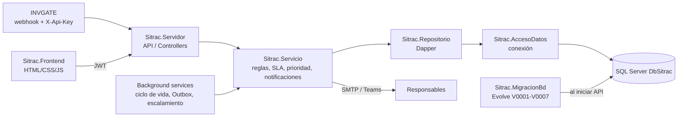

# SITRAC-ANCI

**Sistema de Trazabilidad y Notificación Automática de Incidentes de Ciberseguridad a la ANCI**

[](#información-adicional)
[](#5-metodología-de-trabajo)
[](#1-descripción-del-proyecto)
[](#2-tecnologías-utilizadas)

🇪🇸 Español · [🇬🇧 English](README.en.md)

> Proyecto CAPSTONE 2026 (PTY4614) de Ingeniería en Informática, DuocUC – Escuela de Informática y Telecomunicaciones, sede Valparaíso. Desarrollado en conjunto con la empresa mandante **UltraPort**.

---

## 1. Descripción del proyecto

**¿Qué hace la solución?** SITRAC-ANCI recibe incidentes de ciberseguridad (actualmente desde **INVGATE** mediante webhook, con API key), centraliza su trazabilidad en una base de datos propia y **notifica automáticamente a los responsables** para apoyar el cumplimiento de los plazos de reporte a la **Agencia Nacional de Ciberseguridad (ANCI)**. Registra hitos, historial de acciones, informes preliminares/finales y el avance del ciclo de vida del incidente.

**¿A quién va dirigida?** Al equipo de ciberseguridad y a los responsables de UltraPort que deben gestionar y aprobar las acciones asociadas al reporte normativo.

**¿Qué problema resuelve?** La **Ley N° 21.663** obliga a notificar incidentes en plazos estrictos:

| Hito | Plazo |
| --- | --- |
| Aviso temprano | Máximo **3 horas** desde la toma de conocimiento |
| Informe preliminar | **72 horas** (Esencial) o **24 horas** (OIV), según clasificación |
| Informe final | **15 días** |

**Objetivo general:** automatizar la trazabilidad y notificación de incidentes de ciberseguridad de UltraPort a la ANCI, facilitando el cumplimiento de los plazos de la Ley N° 21.663.

## 2. Tecnologías utilizadas

- **Lenguajes:** C# (.NET 10), T-SQL, HTML, CSS y JavaScript (módulos ES nativos)
- **Backend:** ASP.NET Core Web API (controladores), JWT Bearer, rate limiting, CORS
- **Acceso a datos:** Dapper + `Microsoft.Data.SqlClient` (SQL parametrizado, transacciones)
- **Base de datos:** SQL Server
- **Migraciones:** EvolveDB (scripts versionados `V0001`–`V0007`, ejecutados al iniciar la API)
- **Notificaciones:** MailKit/MimeKit (SMTP) y Microsoft Teams (Incoming Webhook + Adaptive Cards)
- **Procesamiento en segundo plano:** `BackgroundService` + `PeriodicTimer` (ciclo de vida, Outbox, escalamiento SLA)
- **Frontend:** interfaz web estática (`Sitrac.Frontend`, HTML/CSS/JS, sin bundler)
- **Infraestructura local:** Docker / Docker Compose (SQL Server 2022, smtp4dev, API)

> **Nota sobre .NET:** el proyecto apunta a **.NET 10** (`net10.0`) y el SDK se fija en `global.json` a `10.0.400` (`rollForward: latestFeature`).

## 3. Estructura del repositorio

| Proyecto / carpeta | Responsabilidad |
| --- | --- |
| `Sitrac.Servidor/` | API REST, composición DI, autenticación/autorización, rate limiting, CORS y ejecución de migraciones Evolve al arranque |
| `Sitrac.Servicio/` | Reglas de negocio, cálculo de prioridad, ciclo de vida, notificaciones y servicios en segundo plano |
| `Sitrac.Repositorio/` | Modelos y repositorios Dapper (incidentes, hitos, SLA, outbox, escalamiento, usuarios) |
| `Sitrac.AccesoDatos/` | Fábrica de conexiones a SQL Server |
| `Sitrac.MigracionBd/Scripts/` | Migraciones SQL versionadas (`V0001`–`V0007`) |
| `Sitrac.Frontend/` | Consola web (login y gestión operativa) |
| `docker-compose.yml` | Stack local: SQL Server, smtp4dev y API |
| `Sitrac.dockerfile` | Imagen multi-stage de la API |

## 4. Instrucciones para ejecutar el proyecto localmente

### Requisitos

- SDK de .NET 10 (según `global.json`)
- SQL Server (local/Docker) o Docker Desktop para el stack completo
- Servidor estático para el frontend en el puerto `5500` (CORS permitido solo para `http://localhost:5500` y `http://127.0.0.1:5500`)

### Opción A: Docker Compose (recomendada para desarrollo)

```bash
# Desde la raíz del repositorio
docker compose up --build
```

Servicios expuestos:

| Servicio | URL / puerto |
| --- | --- |
| API SITRAC | `http://localhost:5116` |
| SQL Server | `localhost:1433` (sa / `Sitrac2026!Strong`) |
| smtp4dev (captura de correo) | `http://localhost:5000` |

La API ejecuta automáticamente las migraciones Evolve al iniciar y crea la base `DbSitrac` si no existe.

### Opción B: Ejecución local con .NET

```bash
# 1. Restaurar y compilar
dotnet restore Sitrac.sln
dotnet build Sitrac.sln

# 2. Configurar conexión y secretos
#    - ConnectionStrings:SitracConnection
#    - JwtSettings (SecretKey, Issuer, Audience)
#    - WebhookApiKey
#    - SmtpConfig / TeamsConfig / FrontendSettings
#    Recomendado: user-secrets o variables de entorno (no commitear secretos)

# 3. Ejecutar la API
dotnet run --project Sitrac.Servidor/Sitrac.Servidor.csproj --launch-profile http
```

- La API escucha por defecto en `http://localhost:5116` (perfil `http`).
- En entorno Development se habilita Swagger en `/swagger`.
- Las migraciones se aplican al iniciar desde `../Sitrac.MigracionBd/Scripts` relativo al proyecto servidor.

### Frontend

```bash
# Servir en el puerto permitido por CORS
npx serve Sitrac.Frontend -l 5500
# o VS Code Live Server en puerto 5500
```

- Login: `http://localhost:5500/login.html`
- Consola: `http://localhost:5500/index.html`
- La URL base de la API está definida en `Sitrac.Frontend/js/api.js` y `Sitrac.Frontend/js/login.js` (`http://localhost:5116/api`).

## 5. Metodología de trabajo

El proyecto se desarrolla con **Scrum**, con sprints alineados a las semanas de CAPSTONE (10 de agosto al 12 de diciembre de 2026), gestionados en Trello (Product Backlog y Sprint Backlog).

**Ceremonias:** planificación de sprint, Sprint Review con el mandante y retrospectiva.

**Etapas:** levantamiento y formalización de requisitos, diseño de arquitectura y modelo de datos, desarrollo iterativo, pruebas, documentación y presentación final.

La evidencia de gestión Scrum se encuentra en [`Fase 2/Evidencias Proyecto/Evidencias de documentacion`](<Fase 2/Evidencias Proyecto/Evidencias de documentacion>).

## 6. Arquitectura de la solución

Backend por capas en .NET 10, con SQL Server y migraciones Evolve:



| Proyecto | Responsabilidad |
| --- | --- |
| `Sitrac.Servidor` | Controladores API, JWT, rate limiting, CORS, DI y arranque de migraciones |
| `Sitrac.Servicio` | Casos de uso, prioridad, hitos/SLA, notificaciones y workers en segundo plano |
| `Sitrac.Repositorio` | Persistencia y consultas transaccionales (Dapper) |
| `Sitrac.AccesoDatos` | Fábrica de conexiones |
| `Sitrac.MigracionBd` | Scripts de esquema y datos semilla |
| `Sitrac.Frontend` | Consola operativa (login, cola, detalle, acciones, guía) |

### Servicios en segundo plano

| Servicio | Frecuencia | Función |
| --- | --- | --- |
| `AvanzadorCicloVidaServicio` | 1 minuto | Evalúa incidentes activos y avanza estados/hitos según vencimientos SLA (transaccional) |
| `DespachadorNotificacionServicio` | 15 segundos | Procesa la cola Outbox (`TbSitracNotificacionLog`) y envía resúmenes consolidados |
| `EscalamientoSlaServicio` | 1 minuto | Evalúa reglas de escalamiento y envía alertas preventivas con reserva idempotente |

### Endpoints principales

| Método | Ruta | Auth | Descripción |
| --- | --- | --- | --- |
| `POST` | `/api/Auth/login` | No | Autenticación y emisión de JWT |
| `POST` | `/api/Auth/register` | No | Registro de usuario (bootstrap/desarrollo; crea perfil Admin) |
| `POST` | `/api/Incidentes/invgate/webhook` | `X-Api-Key` | Recepción de incidentes desde INVGATE |
| `GET` | `/api/Incidentes` | JWT | Lista incidentes activos |
| `GET` | `/api/Incidentes/{id}` | JWT | Detalle de incidente |
| `GET` | `/api/Incidentes/{id}/historial` | JWT | Historial de eventos |
| `POST` | `/api/Incidentes/{id}/confirmar-aviso` | JWT | Confirma aviso temprano y crea hito de informe preliminar |
| `POST` | `/api/Incidentes/{id}/informe` | JWT | Registra informe preliminar (`P`) o final (`F`) |
| `POST` | `/api/Incidentes/{id}/cerrar` | JWT | Cierra el incidente (requiere informe final registrado) |

### Seguridad y configuración relevante

- **JWT Bearer** para endpoints protegidos (`JwtSettings`).
- **Webhook INVGATE** validado por header `X-Api-Key` (`WebhookApiKey`).
- **Rate limiting global:** 100 solicitudes/minuto por usuario o IP (429 al exceder).
- **CORS:** origenes permitidos `http://localhost:5500` y `http://127.0.0.1:5500`.
- **Notificaciones:** SMTP (`SmtpConfig`) y Teams (`TeamsConfig`, deshabilitado por defecto); incidentes críticos pueden notificarse de inmediato, el resto se consolida vía Outbox.

### Modelo de datos y migraciones

Las migraciones Evolve (`V0001`–`V0007`) crean catálogos, tablas operativas, SLA, informes/revisiones, historial, hitos/escalamiento/outbox y autenticación de usuarios. No editar migraciones ya aplicadas; agregar una nueva versión para cambios posteriores.

---

## Información adicional

### Estado actual

| Componente | Estado |
| --- | --- |
| Modelo de datos y migraciones `V0001`–`V0007` | ✅ |
| Backend por capas (.NET 10), webhook INVGATE con API key | ✅ |
| Cálculo de prioridad y snapshot de plazos SLA | ✅ |
| Hitos, historial y avance automático de ciclo de vida | ✅ |
| Notificaciones SMTP/Teams, Outbox y escalamiento SLA | ✅ |
| Autenticación JWT y login frontend | ✅ Implementado (pendiente hardening para producción) |
| Frontend operativo (login, cola, detalle, acciones) | 🚧 En desarrollo |
| Integración completa con API/credenciales reales de INVGATE | ⏳ Pendiente |
| Falso positivo, revisión de datos personales y canales adicionales | ⏳ Pendiente |

### Alcances y limitaciones conocidas

- MVP acotado al flujo principal de trazabilidad/notificación dentro del periodo CAPSTONE.
- `POST /api/Auth/register` es un endpoint de bootstrap sin protección y crea usuarios `Admin`; debe restringirse/eliminarse para producción.
- El hash sembrado del usuario `admin` en `V0007` es un placeholder no válido para login PBKDF2 real.
- Las URLs de API en frontend y los orígenes CORS están fijados a entorno local; requieren parametrización para despliegue.
- La integración con INVGATE depende de credenciales/configuración del mandante.
- El repositorio no incluye suite de pruebas automatizadas; la verificación actual es build + pruebas manuales.

### Integrantes del equipo y roles

| Integrante | Rol |
| --- | --- |
| Ayala López, Rodrigo | Gestión de Proyecto y Cumplimiento Normativo |
| Soto Aguilar, Benjamín | Desarrollo Backend, arquitectura y pruebas |

- **Empresa mandante:** UltraPort
- **Docente guía:** María Ignacia Cobo

### Referencias

- Ministerio del Interior y Seguridad Pública. (2024, 8 de abril). *Ley 21.663: Ley marco de ciberseguridad e infraestructura crítica de la información*. https://www.bcn.cl/leychile/navegar?idNorma=1202434
- Agencia Nacional de Ciberseguridad. (s.f.). *ANCI*. https://www.anci.gob.cl/
- Schwaber, K., & Sutherland, J. (2020). *The Scrum Guide*. https://scrumguides.org/
- INVGATE. (s.f.). *INVGATE Service Desk*. https://www.invgate.com/

---

<sub>Proyecto académico desarrollado en el marco de la práctica profesional y CAPSTONE, DuocUC sede Valparaíso, con la empresa mandante UltraPort.</sub>
