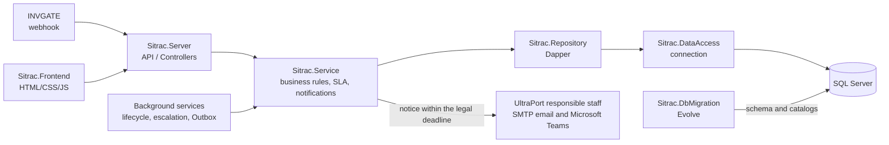

# SITRAC-ANCI

**Incident Traceability and Automatic Notification System for Cybersecurity Incidents to ANCI**

[](#additional-information)
[](#5-work-methodology)
[](#1-project-description)
[](#2-technologies-used)

[🇪🇸 Español](README.md) · 🇬🇧 English

> CAPSTONE 2026 project (PTY4614) for the Computer Engineering program, DuocUC – School of Informatics and Telecommunications, Valparaíso campus. Developed together with the client company **UltraPort**.

---

## 1. Project description

**What does the solution do?** SITRAC-ANCI receives UltraPort's cybersecurity incidents (currently from the **INVGATE** platform via webhook), centralizes their traceability in a dedicated database, and **automatically notifies the responsible people** so that each incident is reported to Chile's **National Cybersecurity Agency (ANCI)** within the legal deadlines. It also records the evidence of every notice sent and of ANCI's response, including false positives.

**Who is it for?** UltraPort's cybersecurity team and the people responsible for approving submissions to ANCI (Enzo, Gonzalo and Ángelo). UltraPort is a port operations company. The approval of any one of the three is enough.

**What problem does it solve?** **Law No. 21.663** requires incidents to be reported to ANCI within strict deadlines:

| Milestone | Deadline |
| --- | --- |
| Initial notification (early warning) | Maximum of **3 hours** from becoming aware of the incident |
| Preliminary report | **72 hours** (UltraPort is an essential entity); **24 hours** if it becomes an OIV, as a configurable parameter |
| Final report | **15 days** |

Today, detection and notification rely on scattered channels (SOC, firewalls, emails, INVGATE tickets), with no unified or traceable mechanism. A recent case showed the gap: a proactive warning from ANCI about a compromised firewall, indirectly linked to UltraPort, did not lead to a ticket or to formal traceability, exposing the company to a real risk of regulatory non-compliance.

**General objective:** automate the traceability and notification of UltraPort's cybersecurity incidents to ANCI, ensuring compliance with the deadlines set by Law No. 21.663.

## 2. Technologies used

- **Languages:** C# (.NET 10), T-SQL, HTML, CSS and JavaScript
- **Frameworks and libraries:** ASP.NET Core (.NET 10), Dapper (data access), MailKit (SMTP email) and Evolve (database migrations)
- **Database:** SQL Server
- **Cloud / Infrastructure:** deployment on UltraPort's own servers, **with no internet exposure**. Integrations with INVGATE (webhook), SMTP and Microsoft Teams
- **Management tools:** GitHub (version control) and Trello (Scrum board)

> **Change from Phase 1:** the preliminary stack included Node.js and Angular. After learning UltraPort's specifications, it was adjusted to their Catalog of Authorized Technologies.
>
> **Note on the .NET version:** the initial standard defined by UltraPort was .NET 8. On September 16, 2026, in an in-person meeting, the team warned UltraPort that .NET 8 reaches end of support on November 10, 2026, and the project was migrated to **.NET 10 (LTS)**.

## 3. Instructions to run the project locally

**Requirements:** .NET 10 SDK (version pinned in `global.json`) and SQL Server (Express is enough).

```bash
# 1. Clone the repository
git clone https://github.com/gasparin2702/Capstone-Soto-Ayala.git
cd "Capstone-Soto-Ayala/Fase 2/Evidencias Proyecto/Evidencias de sistema"

# 2. Configure the connection and the notification channels
#    Edit Sitrac.Server/appsettings.Development.json
#    (SQL Server connection string, SMTP, Teams and frontend base URL)

# 3. Create the schema and populate the catalogs
#    Run the Sitrac.DbMigration scripts (V0001 to V0006) with Evolve

# 4. Start the server
dotnet run --project Sitrac.Server
```

- **Ports:** defined in `Sitrac.Server/Properties/launchSettings.json`.
- **API testing:** the `Sitrac.Server/Sitrac.Server.http` file contains sample requests.
- **Frontend:** `Sitrac.Frontend/index.html` consumes the server's API.
- **Credentials:** the repository does not include real credentials. Connection data and SMTP/Teams settings must be configured locally.

## 4. Team members and roles

| Member | Role |
| --- | --- |
| Ayala López, Rodrigo | Project Management and Regulatory Compliance: backlog, monitoring of Law No. 21.663, coordination with UltraPort and sprint facilitation |
| Soto Aguilar, Benjamín | Backend Development: backend, architecture and system testing |

Both take part in the architecture, testing, retrospectives and presentations, with no hierarchy between them.

- **Client company:** UltraPort (contacts: Enzo Badillo and Gonzalo Crosier)
- **Thesis advisor:** María Ignacia Cobo

## 5. Work methodology

The project is developed with **Scrum**, with sprints aligned to the CAPSTONE weeks (August 10 to December 12, 2026). Work is managed on a **Trello board** with the Product Backlog and the Sprint Backlog.

**Ceremonies:** sprint planning, Sprint Review with the client and retrospective.

**Stages:**

1. Requirements gathering and formalization (SRS under the IEEE 830 standard).
2. Architecture and data model design.
3. Iterative development of the backend and the traceability platform.
4. Testing, documentation and final presentation.

**Why Scrum?** It allows the information that UltraPort provides progressively to be incorporated in each sprint, the client anticipated more than one iteration, and the team holds the SCRUM-ITF certification. The traditional approach (SDLC/RUP) was discarded because its heavy upfront documentation does not fit changing requirements, and so was Design Thinking, because it does not apply to a backend integration governed by regulation.

Evidence of the Scrum management is in [`Fase 2/Evidencias Proyecto/Evidencias de documentacion`](<Fase 2/Evidencias Proyecto/Evidencias de documentacion>).

## 6. Solution architecture

Layered backend in .NET 10, with a SQL Server database versioned through migrations:



| Project | Responsibility |
| --- | --- |
| `Sitrac.Server` | REST API and incident intake (controllers) |
| `Sitrac.Service` | Business rules, priority calculation, incident lifecycle advancement, notifications (email and Teams) and background services |
| `Sitrac.Repository` | Models and repositories (incidents, milestones, SLA, escalation rules and notification log) |
| `Sitrac.DataAccess` | Database connection factory |
| `Sitrac.DbMigration` | Versioned migration scripts |
| `Sitrac.Frontend` | Web interface (HTML, CSS and native JS) |

**Background services:**

| Service | Frequency | Function |
| --- | --- | --- |
| `LifecycleAdvancerService` | 1 minute | Advances the incident status and creates and closes milestones transactionally |
| `SlaEscalationService` | 1 minute | Sends preventive alerts based on the escalation rules before a milestone expires |
| `NotificationDispatcherService` | 15 seconds | Consumes the Outbox queue and sends summaries consolidated by severity |

**Notifications:** high-priority incidents are notified immediately by email and Microsoft Teams; the rest go through an Outbox queue and are consolidated. Notices include a direct link to the platform.

**Main endpoints:**

| Method | Endpoint | Description |
| --- | --- | --- |
| `POST` | `/api/incidentes/invgate/webhook` | Receives incidents from INVGATE |
| `GET` | `/api/incidentes`, `/api/incidentes/{id}`, `/api/incidentes/{id}/historial` | List, detail and history |
| `POST` | `/api/incidentes/{id}/confirmar-aviso` | Confirms the early warning and creates the preliminary report milestone |
| `POST` | `/api/incidentes/{id}/informe` | Registers the preliminary or final report |
| `POST` | `/api/incidentes/{id}/cerrar` | Closes the incident |

**Business flows** (accepted by UltraPort):

| Flow 1: detection and early warning | Flow 2: ANCI response and internal confirmation | Flow 3: preliminary report, final report and status |
| --- | --- | --- |
|  |  |  |

**Incident entry points:** INVGATE ticket, incoming email from ANCI, registration via Microsoft Teams, email from the cybersecurity team, and manual registration in SITRAC (email and Teams are mandatory).

Technical details are in [`ARCHITECTURE.md`](<Fase 2/Evidencias Proyecto/Evidencias de sistema/ARCHITECTURE.md>).

### Technical documentation

| Document | Content |
| --- | --- |
| [`ARCHITECTURE.md`](<Fase 2/Evidencias Proyecto/Evidencias de sistema/ARCHITECTURE.md>) | Layers, components, flows, data model and configuration |
| [`Diagramas-UML.md`](<Fase 2/Evidencias Proyecto/Evidencias de documentacion/Diagramas-UML.md>) | UML use case, class, sequence and component diagrams (in Spanish) |
| [`Requisitos-No-Funcionales.md`](<Fase 2/Evidencias Proyecto/Evidencias de documentacion/Requisitos-No-Funcionales.md>) | Performance, security, availability and usability requirements with measurable values (in Spanish) |

---

### Innovation section (closing document)

- **What problem does it solve?** It removes the reliance on scattered channels and manual notices to meet the 3-hour, 72-hour and 15-day deadlines of Law No. 21.663, and leaves formal traceability of every incident.
- **What makes the solution different?** It unifies the different incident entry points into a single traceable flow, calculates SLA deadlines automatically with configurable parameters, and lets any of the responsible people approve a submission from a direct link to the platform.
- **What value does it add?** It reduces the risk of regulatory non-compliance, provides auditable evidence of every notice and response, and speeds up the reaction to an incident, aligned with UltraPort's stack and standards.

---

## Additional information

### Status and schedule

| Phase | Content | Status |
| --- | --- | --- |
| **Phase 1** | APT project definition: Product Backlog, supporting SRS, technical report and presentation of the project idea | ✅ Completed |
| **Phase 2** | Sprint 1 (UltraPort parameters, database and environment) and Sprint 2 (backend, incident intake and notifications), plus Sprint Review and progress report | 🚧 In development |
| **Phase 3** | Certification testing and project closure | ⏳ Pending |

**Phase 2 progress**

| Component | Status |
| --- | --- |
| Normalized data model and data dictionary | ✅ |
| Evolve migrations `V0001` to `V0006` | ✅ |
| Layered backend (.NET 10) and webhook intake | ✅ |
| Priority and SLA deadline calculation | ✅ |
| Frontend (registration and tracking) | 🚧 |
| Notification delivery (SMTP / Teams), escalation and Outbox queue | ✅ |
| Full INVGATE integration (awaiting credentials from UltraPort) | ⏳ |
| Endpoint authentication and authorization | ⏳ |
| False positive, personal data review and registration by email, Teams or manually | ⏳ |

### Scope and limitations

- MVP limited to a specific traceability and notification flow, within the 18 weeks of CAPSTONE.
- The client warned that the full scope will probably require more than one iteration; this is mitigated by limiting the MVP.
- INVGATE credentials and API have not yet been delivered, so incidents currently enter only through webhook.
- The endpoints do not yet have authentication or authorization; this is planned with Microsoft Entra ID or JWT.
- The tables for false positives, personal data review and ANCI communications exist, but do not have endpoints yet.
- The current schedule is 2 hours per day; the move to office hours (9:00–17:00) has not yet been formalized.

### Repository structure

```text
.
├── Fase 1/                               # Phase 1
│   ├── Evidencias Grupales/              # Group evidence
│   └── Evidencias Individuales/          # Individual evidence
├── Fase 2/                               # Phase 2
│   ├── Evidencias Grupales/
│   ├── Evidencias Individuales/
│   └── Evidencias Proyecto/
│       ├── Evidencias de documentacion/  # Data dictionary, flows, UML, non-functional requirements, Scrum management, normalized model
│       └── Evidencias de sistema/        # .NET solution (Sitrac.sln)
│           ├── Sitrac.DataAccess/
│           ├── Sitrac.DbMigration/       # Scripts V0001–V0006
│           ├── Sitrac.Frontend/
│           ├── Sitrac.Repository/
│           ├── Sitrac.Server/
│           ├── Sitrac.Service/
│           └── ARCHITECTURE.md
├── Fase 3/                               # Phase 3 (pending)
├── README.md                             # Spanish version
└── README.en.md                          # English version
```

### References

- Ministerio del Interior y Seguridad Pública. (2024, April 8). *Ley 21.663: Ley marco de ciberseguridad e infraestructura crítica de la información*. Diario Oficial de la República de Chile. https://www.bcn.cl/leychile/navegar?idNorma=1202434
- Agencia Nacional de Ciberseguridad. (n.d.). *ANCI*. Government of Chile. https://www.anci.gob.cl/
- Schwaber, K., & Sutherland, J. (2020). *The Scrum Guide*. https://scrumguides.org/
- INVGATE. (n.d.). *INVGATE Service Desk*. https://www.invgate.com/

---

<sub>Academic project developed as part of the professional internship and CAPSTONE, DuocUC Valparaíso campus, with the client company UltraPort.</sub>
