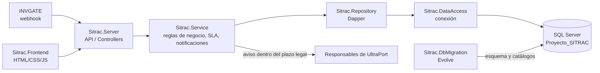

# SITRAC-ANCI

**Sistema de Trazabilidad y Notificación Automática de Incidentes de Ciberseguridad a la ANCI**

[](#información-adicional)
[](#5-metodología-de-trabajo)
[](#1-descripción-del-proyecto)
[](#2-tecnologías-utilizadas)

🇪🇸 Español · [🇬🇧 English](README.en.md)

> Proyecto CAPSTONE 2026 (PTY4614) de Ingeniería en Informática, DuocUC – Escuela de Informática y Telecomunicaciones, sede Valparaíso. Desarrollado en conjunto con la empresa mandante **UltraPort**.

---

## 1. Descripción del proyecto

**¿Qué hace la solución?** SITRAC-ANCI recibe los incidentes de ciberseguridad de UltraPort (hoy, desde la plataforma **INVGATE** mediante webhook), centraliza su trazabilidad en una base de datos propia y **notifica automáticamente a los responsables** para que el incidente se informe a la **Agencia Nacional de Ciberseguridad (ANCI)** dentro de los plazos legales. Registra además la evidencia de cada aviso y de la respuesta de la ANCI, incluyendo los falsos positivos.

**¿A quién va dirigida?** Al equipo de ciberseguridad y a los responsables de UltraPort (Enzo, Gonzalo y Ángelo), empresa de operaciones portuarias, que aprueban los envíos hacia la ANCI. Basta la aprobación de cualquiera de los tres.

**¿Qué problema resuelve?** La **Ley N° 21.663** obliga a notificar los incidentes a la ANCI en plazos estrictos:

| Hito | Plazo |
| --- | --- |
| Notificación inicial (aviso temprano) | Máximo **3 horas** desde la toma de conocimiento |
| Informe preliminar | **72 horas** (UltraPort es empresa esencial); **24 horas** si pasara a OIV, como parámetro configurable |
| Informe final | **15 días** |

Hoy la detección y el aviso dependen de canales dispersos (SOC, firewalls, correos, tickets de INVGATE), sin un mecanismo unificado ni trazable. Un antecedente reciente lo evidenció: un aviso proactivo de la ANCI sobre un firewall vulnerado, vinculado indirectamente a UltraPort, no derivó en un ticket ni en trazabilidad formal, lo que expone a la empresa a un riesgo real de incumplimiento normativo.

**Objetivo general:** automatizar la trazabilidad y notificación de incidentes de ciberseguridad de UltraPort a la ANCI, garantizando el cumplimiento de los plazos de la Ley N° 21.663.

## 2. Tecnologías utilizadas

- **Lenguajes:** C# (.NET 8), T-SQL, HTML, CSS y JavaScript
- **Frameworks y librerías:** ASP.NET Core (.NET 8), Dapper (acceso a datos) y Evolve (migraciones de base de datos)
- **Base de datos:** SQL Server
- **Cloud / Infraestructura:** despliegue en servidores propios de UltraPort, **sin exposición a internet**. Integraciones con INVGATE (webhook), SMTP y Microsoft Teams
- **Herramientas de gestión:** GitHub (control de versiones) y Trello (tablero Scrum)

> **Cambio respecto a la Fase 1:** el stack preliminar incluía Node.js y Angular. Al conocer las especificaciones de UltraPort, se ajustó a su Catálogo de Tecnologías Autorizadas.
>
> ⚠️ **Nota sobre .NET 8:** su uso es un estándar obligatorio definido por UltraPort. El equipo advirtió a UltraPort, en reunión presencial el 16 de septiembre de 2026, que .NET 8 llega a fin de soporte el 10 de noviembre de 2026; UltraPort se hará cargo de la situación.

## 3. Instrucciones para ejecutar el proyecto localmente

**Requisitos:** SDK de .NET 8 (versión fijada en `global.json`) y SQL Server (Express es suficiente).

```bash
# 1. Clonar el repositorio
git clone https://github.com/gasparin2702/Capstone-Soto-Ayala
cd "<repositorio>/Fase 2/Evidencias Proyecto/Evidencias de sistema"

# 2. Configurar la conexión y los canales de notificación
#    Editar Sitrac.Server/appsettings.Development.json
#    (cadena de conexión a SQL Server y configuración de SMTP y Teams)

# 3. Crear el esquema y poblar los catálogos
#    Ejecutar los scripts de Sitrac.DbMigration (V0001 a V0006) con Evolve

# 4. Levantar el servidor
dotnet run --project Sitrac.Server
```

- **Puertos:** se definen en `Sitrac.Server/Properties/launchSettings.json`.
- **Pruebas de la API:** el archivo `Sitrac.Server/Sitrac.Server.http` contiene ejemplos de solicitudes.
- **Frontend:** `Sitrac.Frontend/index.html` consume la API del servidor.
- **Credenciales:** el repositorio no incluye credenciales reales. Los datos de conexión y de SMTP/Teams deben configurarse localmente.

## 4. Integrantes del equipo y roles

| Integrante | Rol |
| --- | --- |
| Ayala López, Rodrigo | Gestión de Proyecto y Cumplimiento Normativo: backlog, seguimiento de la Ley N° 21.663, coordinación con UltraPort y facilitación de sprints |
| Soto Aguilar, Benjamín | Desarrollo Backend: backend, arquitectura y pruebas del sistema |

Ambos participan en la arquitectura, las pruebas, las retrospectivas y las presentaciones, sin jerarquía entre ellos.

- **Empresa mandante:** UltraPort (contrapartes: Enzo Vadillo y Gonzalo Crosier)
- **Docente guía:** María Ignacia Cobo

## 5. Metodología de trabajo

El proyecto se desarrolla con **Scrum**, con sprints alineados a las semanas de CAPSTONE (10 de agosto al 12 de diciembre de 2026). La gestión se realiza en un **tablero de Trello** con el Product Backlog y el Sprint Backlog.

**Ceremonias:** planificación de sprint, Sprint Review con el mandante y retrospectiva.

**Etapas:**

1. Levantamiento y formalización de requisitos (ERS bajo el estándar IEEE 830).
2. Diseño de arquitectura y modelo de datos.
3. Desarrollo iterativo del backend y la plataforma de trazabilidad.
4. Pruebas, documentación y presentación final.

**¿Por qué Scrum?** Permite incorporar en cada sprint la información que UltraPort entrega de forma progresiva, el mandante anticipó más de una iteración y el equipo cuenta con certificación SCRUM-ITF. Se descartaron el enfoque tradicional (SDLC/RUP), por su documentación previa incompatible con requisitos cambiantes, y Design Thinking, por no aplicar a una integración backend gobernada por normativa.

La evidencia de la gestión Scrum está en [`Fase 2/Evidencias Proyecto/Evidencias de documentacion`](<Fase 2/Evidencias Proyecto/Evidencias de documentacion>).

## 6. Arquitectura de la solución

Backend por capas en .NET 8, con base de datos SQL Server versionada mediante migraciones:



| Proyecto | Responsabilidad |
| --- | --- |
| `Sitrac.Server` | API y recepción de incidentes (controllers) |
| `Sitrac.Service` | Reglas de negocio, cálculo de prioridad, avance del ciclo de vida del incidente y notificaciones |
| `Sitrac.Repository` | Modelos y repositorios (incidentes, hitos, SLA, reglas de escalamiento y log de notificaciones) |
| `Sitrac.DataAccess` | Fábrica de conexiones a la base de datos |
| `Sitrac.DbMigration` | Scripts de migración versionados |
| `Sitrac.Frontend` | Interfaz web (HTML, CSS y JS nativo) |

**Flujos de negocio** (aceptados por UltraPort):

| Flujo 1: detección y aviso temprano | Flujo 2: respuesta ANCI y confirmación interna | Flujo 3: informe preliminar, final y estado |
| --- | --- | --- |
|  |  |  |

**Puntos de entrada de incidentes:** ticket de INVGATE, correo entrante de la ANCI, registro vía Microsoft Teams, correo del equipo de ciberseguridad y registro manual en SITRAC (obligatorios: correo y Teams).

El detalle técnico está en [`ARCHITECTURE_REFERENCE.md`](ARCHITECTURE_REFERENCE.md).

---

### Sección de innovación (documento de cierre)

- **¿Qué problema resuelve?** Elimina la dependencia de canales dispersos y de avisos manuales para cumplir los plazos de 3 horas, 72 horas y 15 días de la Ley N° 21.663, y deja trazabilidad formal de cada incidente.
- **¿Qué hace diferente a la solución?** Unifica en un solo flujo trazable los distintos puntos de entrada de incidentes, calcula los plazos SLA de forma automática con parámetros configurables y permite que cualquiera de los responsables apruebe el envío desde un enlace directo a la plataforma.
- **¿Qué valor agrega?** Reduce el riesgo de incumplimiento normativo, entrega evidencia auditable de cada aviso y respuesta, y acelera la reacción ante un incidente, alineada al stack y a los estándares de UltraPort.

---

## Información adicional

### Estado y cronograma

| Fase | Contenido | Estado |
| --- | --- | --- |
| **Fase 1** | Definición del proyecto APT: Product Backlog, ERS de apoyo, informe técnico y presentación de la idea | ✅ Completada |
| **Fase 2** | Sprint 1 (parámetros de UltraPort, base de datos y entorno) y Sprint 2 (backend, recepción de incidentes y notificaciones), más Sprint Review e informe de avance | 🚧 En desarrollo |
| **Fase 3** | Pruebas de certificación y cierre del proyecto | ⏳ Pendiente |

**Avance de la Fase 2**

| Componente | Estado |
| --- | --- |
| Modelo de datos normalizado y diccionario de datos | ✅ |
| Migraciones Evolve `V0001` a `V0006` | ✅ |
| Backend por capas (.NET 8) y recepción por webhook | 🚧 |
| Cálculo de prioridad y plazos SLA | 🚧 |
| Frontend (registro y seguimiento) | 🚧 |
| Envío de notificaciones (SMTP / Teams) | ⏳ |
| Integración completa con INVGATE (a la espera de credenciales de UltraPort) | ⏳ |

### Alcances y limitaciones

- MVP acotado a un flujo específico de trazabilidad y notificación, dentro de las 18 semanas de CAPSTONE.
- El mandante advirtió que el alcance completo probablemente requiera más de una iteración; se mitiga acotando el MVP.
- Las credenciales y la API de INVGATE aún no han sido entregadas, por lo que hoy los incidentes ingresan solo por webhook.
- La jornada actual es de 2 horas diarias; la migración a jornada de oficina (9:00–17:00) aún no está formalizada.

### Estructura del repositorio

```text
.
├── Fase 1/
│   ├── Evidencias Grupales/
│   └── Evidencias Individuales/
├── Fase 2/
│   ├── Evidencias Grupales/
│   ├── Evidencias Individuales/
│   └── Evidencias Proyecto/
│       ├── Evidencias de documentacion/  # Diccionario de datos, flujos, gestión Scrum, modelo normalizado
│       └── Evidencias de sistema/        # Solución .NET (Sitrac.sln)
│           ├── Sitrac.DataAccess/
│           ├── Sitrac.DbMigration/       # Scripts V0001–V0006
│           ├── Sitrac.Frontend/
│           ├── Sitrac.Repository/
│           ├── Sitrac.Server/
│           ├── Sitrac.Service/
│           └── ARCHITECTURE_REFERENCE.md
├── Fase 3/                               # Pendiente
├── README.md                             # Versión en español
└── README.en.md                          # English version
```

### Referencias

- Ministerio del Interior y Seguridad Pública. (2024, 8 de abril). *Ley 21.663: Ley marco de ciberseguridad e infraestructura crítica de la información*. Diario Oficial de la República de Chile. https://www.bcn.cl/leychile/navegar?idNorma=1202434
- Agencia Nacional de Ciberseguridad. (s.f.). *ANCI*. Gobierno de Chile. https://www.anci.gob.cl/
- Schwaber, K., & Sutherland, J. (2020). *The Scrum Guide*. https://scrumguides.org/
- INVGATE. (s.f.). *INVGATE Service Desk*. https://www.invgate.com/

---

<sub>Proyecto académico desarrollado en el marco de la práctica profesional y CAPSTONE, DuocUC sede Valparaíso, con la empresa mandante UltraPort.</sub>
